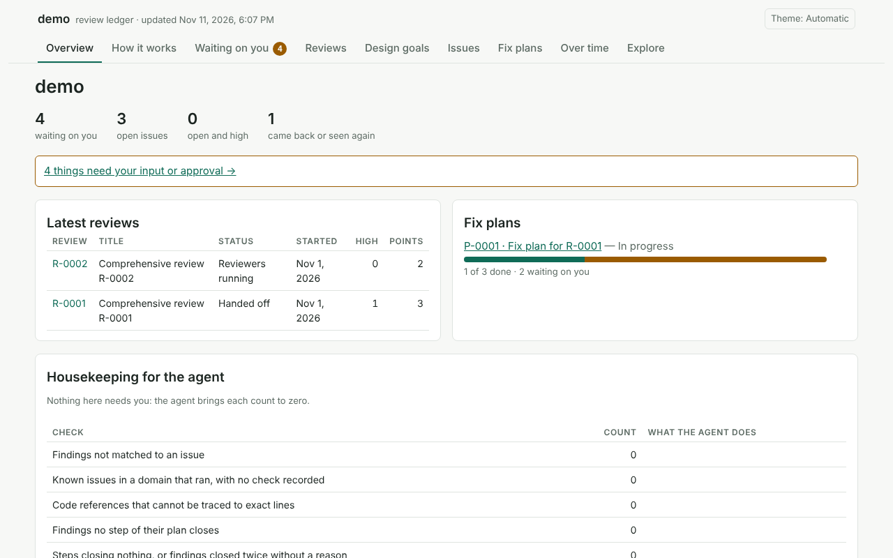

# codebase-system-review

A skill for a managed, multi-reviewer code review, with a per-project SQLite ledger and a local viewer. The canonical
copy is https://github.com/dylanrussellmd/codebase-system-review-skill (MIT licence, `LICENSE`; changes in
`CHANGELOG.md`).

    codebase-system-review/          the installed skill: exactly these four
    ├── SKILL.md                     the instructions the agent follows (read in full on every use)
    ├── README.md, LICENSE
    ├── scripts/ledger.py            ledger tool and viewer (Python 3.9+, no dependencies; built, never edited)
    └── references/                  read when SKILL.md says: environment.md, domains.md, brief.md, indexing.md,
                                     fix-plan.md, recipes.md, implementer-brief.md, writing.md, determinism.md,
                                     tools.md and tools.jsonl (tools a review could run), formats/, vale/,
                                     migrations/, schema.sql (the schema's source of truth, built into ledger.py)

    dev/                             in the repository only, not in the bundle
    ├── core.py, page.html           the sources of scripts/ledger.py
    ├── build.py, release.py         build ledger.py; build the bundle zip
    └── tests/                       the test suite, seed_demo.py, fixtures

## Install

From a release: `python3 dev/release.py` in a clone writes `dist/codebase-system-review-<version>.zip`; unzip it into
a skills folder below. From a clone: copy or symlink `SKILL.md`, `scripts/` and `references/` into a folder named
`codebase-system-review` there. The folder must have exactly that name, the `name:` in SKILL.md: a clone checked out
under another name (such as `codebase-system-review-skill`) is not found, or is found under the wrong name.

| harness | skills folder | it loads the skill |
|---------|---------------|--------------------|
| OpenCode, every project | `~/.config/opencode/skills/` (also reads `~/.claude/skills/` and `~/.agents/skills/`) | when a request matches the description, or `@codebase-system-review` |
| OpenCode, one project | `<project>/.opencode/skills/` (also `.claude/skills/`, `.agents/skills/`) | the same |
| Claude Code, every project | `~/.claude/skills/` | when a request matches the description, or `/codebase-system-review` |
| Claude Code, one project | `<project>/.claude/skills/` | the same |
| others | the harness's skills folder | as the harness documents |

Then ask the agent to run a comprehensive review of the system (or name the skill). A harness that was running when
the folder appeared may need a restart or its reload command.

The skill depends on no one harness or model. `ledger.py env` lists what the machine and the harness offer (git,
Playwright and a browser, Lighthouse, the harness's connectors by name); `references/environment.md` gives the way
without each. Playwright is optional: `ledger.py ui-capture` and `ledger.py ui-audit` screenshot and measure rendered
pages with it, and print the install line and exit 2 without it. `references/tools.md` lists the tools a review could
run per domain, each optional with a fallback.

Everything code can decide, the tool decides, so two runs on the same commit agree: `scan` proposes the domains by
rule, `brief` and `prompt` generate the texts reviewers get, `lint-report` checks what they hand back, `match --auto`
matches what the data decides, `conflicts` finds plan steps that touch the same thing, and `compare-runs` measures
how far two runs differ (`references/determinism.md` lists what is left to judgement).

To uninstall, delete the `codebase-system-review` folder from the skills folder. To remove a project's ledger, delete
its `.code-review/` folder, the line for it in `.git/info/exclude` or `.gitignore`, and the local review tags
(`git tag -l 'review/*' | xargs git tag -d`).

## What the ledger stores

One SQLite file per project, written only through `ledger.py`:

| group | tables |
|-------|--------|
| who and what | `repositories`, `actors` (people and each agent instance), `domains`, `themes`, `requirements`, `design_goals` |
| reviews | `reviews` (scope, status, the owner's request, verdict), `review_repositories` (commits, uncommitted changes), `review_domains`, `reviewer_runs` (prompt, report, counts) |
| points and issues | `findings` (one point of one review) with `finding_locations` (exact lines at a commit, with the excerpt); `issues` (the problem followed across reviews), `issue_relations`, `review_issue_checks`, `events` (full history) |
| fixing | `plans`, `phases`, `steps`, `step_dependencies`, `step_findings`, `step_commits`, `guard_tests` |
| the owner | `gates` (questions and their answers), `decisions`, interview questions and answers |
| over time | `test_runs`, `metrics`, `artifacts` |

`ledger.py schema` prints every table, column and view with its comment.

**Privacy.** The ledger holds excerpts of the cited code, the owner's answers in their own words, prompts, model
names and connector names. Anyone who can read the file can read all of it; in a public repository that is everyone.
`fill-refs` masks common secret shapes, not all; `ledger.py redact` removes one that got through.

## Where the ledger lives

In `<project root>/.code-review/` (owner-only: the folder 0700, the files 0600): the ledger, the copy of the tool, the
dump, the hub page, saved patches and each review's brief, reports and indexes. The owner decides at the first review
what is committed: nothing, only `ledger.sql`, or only `ledger.sqlite` (about 9 MB of ledger and 7 MB of dump per
1,000 findings). Until then the agent lists `.code-review/` in `.git/info/exclude` and commits nothing. Review tags
(`review/R-0001`) stay local unless that decision says to push them. `CODE_REVIEW_DIR=/some/folder` for every command
(or `--db FILE`) writes nothing inside the repository. This repository keeps its own ledger out (decision D-0001:
`.code-review/` is in `.gitignore`).

Each project keeps a copy of the tool at `.code-review/ledger.py`. Review a pull request that changes that copy or the
ledger's schema like any other code change. `ledger.py check` fails when the ledger's tables, views or triggers differ
from the shipped schema. Agents run the skill's own `scripts/ledger.py`, and the project copy only right after `init`
refreshed it; `init` prints the sha256 of the copy it wrote, to compare with the skill's.

The ledger runs in SQLite's WAL mode (`init` sets it; `migrate` switches an existing ledger once), so the viewer's
reads never block the agent's writes. While it is open, `ledger.sqlite-wal` and `ledger.sqlite-shm` sit beside it
(`.code-review/.gitignore` lists them). That needs:

- a folder where SQLite can create the `-shm` file beside the database (also for read-only use);
- a local disk: WAL does not work on network file systems (NFS, SMB);
- a checkpoint before the `.sqlite` file is copied or committed: `ledger.py dump` runs
  `PRAGMA wal_checkpoint(TRUNCATE)` first, so after `dump` the file holds every commit.

## Maintaining a ledger

    ledger.py dump                                           write .code-review/ledger.sql (text, diffable)
    ledger.py restore .code-review/ledger.sql --to new.sqlite   rebuild a ledger from the dump into a new file, then check it
    ledger.py migrate                                        upgrade an older ledger (keeps ledger.sqlite.bak-v<N>)
    ledger.py merge /tmp/theirs.sqlite                       after a git merge conflict on ledger.sqlite
    ledger.py check                                          integrity and must-be-empty checks

For a merge conflict, keep one side as the ledger, save the other
(`git show MERGE_HEAD:.code-review/ledger.sqlite > /tmp/theirs.sqlite`) and run `merge`: shared rows are kept once,
codes both sides made are renumbered (the mapping is printed), and the ledger before the merge is kept as
`ledger.sqlite.bak-merge`. `ledger.py --version` prints the tool and schema versions; `init` replaces
`.code-review/ledger.py` only with a newer copy, keeping `ledger.py.bak` (`--force` also replaces a newer one).

## Use the viewer

After every review step and fix batch the agent writes the hub: the viewer as one file (`.code-review/hub.html`,
`ledger.py progress-page`). Answers given in the hub file download as `answers.json` (a published copy with an answer
store exports the same file); `ledger.py import-answers` records them. Publishing it elsewhere is optional.

The live viewer, from the project root, runs the skill's copy of ledger.py, not the project's `.code-review/ledger.py`
(run that one only right after `init` refreshed it):

    python3 <skill folder>/scripts/ledger.py --root . serve

It listens on 127.0.0.1 only and prints the link to open (the link carries the viewer's key). `--port 8766` picks
another port when 8765 is in use; `--no-open` leaves the browser alone. Each request is logged to that terminal as
one line (time, method, path, status, milliseconds), never the key or what was typed. To view it from another
machine, forward the port and open the printed link there:

    ssh -L 8765:127.0.0.1:8765 host

Use the same port number on both ends: the viewer only answers the address it was started on. The hub file needs
no server and can be read anywhere.

## Developing

`scripts/ledger.py` is generated; edit the sources, never the generated file:

    dev/core.py              CLI, checks, git helpers, viewer API and server
    dev/page.html            the viewer page
    references/schema.sql    the schema: the source of truth, built into ledger.py
    references/migrations/   one file per schema version

From the repository root (`DEMO` is a new or empty folder; leave it out to get a temporary one):

    python3 dev/build.py                          regenerate scripts/ledger.py
    python3 dev/build.py --check                  exit 1 if scripts/ledger.py is stale
    python3 dev/tests/seed_demo.py DEMO           a small git project with a filled ledger (reviews, a plan, gates)
    python3 scripts/ledger.py --version           print the tool version (from SKILL.md) and the schema version
    python3 scripts/ledger.py --root DEMO check   the demo ledger passes every check
    python3 scripts/ledger.py --root DEMO serve   open the viewer on it (Ctrl+C to stop)
    python3 dev/release.py                        rebuild ledger.py, check SKILL.md's frontmatter, write dist/*.zip

`seed_demo.py` makes the folder a git repository with two commits, runs `init` and fills the ledger itself; it prints
FAIL and exits 1 when the demo ledger is not what it expects. `dev/tests/test_docs.py` runs these commands and checks
every `ledger.py` command SKILL.md names.

`release.py` writes `dist/codebase-system-review-<version>.zip` (`dist/` is ignored by git): one folder named as
SKILL.md's `name:`, with exactly SKILL.md, README.md, LICENSE, `scripts/ledger.py` and `references/`, dated so the
same sources give the same bytes. It refuses, writing nothing, when `name:` is not `codebase-system-review`, the
description is empty or over 1,024 characters, `version:` under `metadata:` is not X.Y.Z, or the frontmatter has a
top-level key other than `name`, `description`, `license`, `compatibility`, `metadata` and `allowed-tools` (some skill
loaders refuse any other). To release: bump `metadata:` `version:` in SKILL.md, add the version to CHANGELOG.md, run the
tests and `release.py`, commit, tag `v<version>` and attach the zip to a GitHub release.

Write SKILL.md, this file and `references/` to `references/writing.md`; `dev/tests/test_writing_lint.py` refuses its
banned phrases (CHANGELOG.md is exempt). `SKILL.md` and `references/*.md` never put an exclamation mark right before a
code span or a code fence's language: some harnesses run such a block when they load the skill. `SKILL.md` stays
within 375 lines; longer material goes in `references/`.

## Testing

From the repository root (Python 3.9+, standard library only; tested on Python 3.9.0, 3.9.25 and 3.13, and on
SQLite 3.31 to 3.53):

    python3 -m unittest discover -s dev/tests -t . -v

The tests build `scripts/ledger.py` from the sources into a temporary folder and test that build. Everything they
create (scratch git repositories, ledgers, viewer servers on free ports) lives in a temporary folder removed when the
run ends. Skipped by default:

- scale tests on large generated ledgers (`dev/tests/scale.py`; `--help` for a standalone build): `LEDGER_SLOW_TESTS=1`;
- browser tests: `LEDGER_BROWSER_TESTS=1`, with Playwright and Chrome or Chromium
  (`pip install playwright && python3 -m playwright install chromium`).

CI (`.github/workflows/ci.yml`) runs `python3 dev/build.py --check` and the suite on Python 3.9 and 3.12 for every
push and pull request, and the slow and browser tests in their own jobs.

Shared test builders (scratch repositories, ledgers, the demo data, a viewer server) are in `dev/tests/fixtures.py`,
measuring helpers in `dev/tests/helpers.py`, baseline numbers in `dev/tests/perf_baseline.json`.

Commit `scripts/ledger.py` with every change to `dev/core.py`, `dev/page.html` or `references/schema.sql`. The build
pastes the schema and the page into raw triple-quoted strings in core.py. It refuses, writing nothing, when either
contains three double quotes in a row or ends with a backslash or a double quote, or when a placeholder
(`@@SCHEMA@@`, `@@PAGE@@`) does not appear exactly once in core.py and nowhere else.

## Changing the schema

A schema change ships as a numbered migration, never as an edit alone. `migrate` upgrades a ledger from any schema
since 1 (frozen in `dev/tests/data/schema-v1.sql`):

1. Add `references/migrations/NNNN-<slug>.sql` (the next number; lowercase slug). Its first line is
   `-- <description>`. It holds only what changes tables, indexes and data, from schema NNNN-1 to NNNN. Views and
   triggers are not migrated by hand: `migrate` drops every one before the steps run and re-creates them from
   `references/schema.sql` afterwards. To change a table's columns or constraints use SQLite's table-rebuild recipe
   (create `<table>_new`, copy the rows, drop the old table, rename the new one, re-create its indexes); foreign keys
   are off while the steps run and `PRAGMA foreign_key_check` must be clean at the end.
2. Edit `references/schema.sql` to the new end state, and in the same change set its header line to `schema version
   NNNN`, the meta seed to `'NNNN'`, and add `(NNNN, '<description>')` to the `schema_migrations` seed. The build
   refuses if any of these disagrees with the highest migration (`SCHEMA_VERSION` in ledger.py is that number).
3. Add a test that restores the frozen v1 ledger (`dev/tests/_migrate_helpers.py`), runs `migrate`, and checks the
   result against a fresh `init` (`dev/tests/test_migrate.py` shows how); then rebuild with `python3 dev/build.py`.
4. Bump `metadata:` `version:` in SKILL.md's frontmatter and add a line to CHANGELOG.md.

A migration file stays as it is once any ledger has run it. `migrate` refuses a ledger newer than the
tool, backs the ledger up with SQLite's backup API to `ledger.sqlite.bak-v<old version>` (never overwriting an earlier
backup), applies every pending step in one `BEGIN IMMEDIATE` transaction, records each in `schema_migrations`, sets
`meta.schema_version` and `PRAGMA user_version`, and rolls everything back (removing the backup, the ledger
byte-identical) if a step fails, a foreign key breaks, or the result differs from a fresh build of
`references/schema.sql`. `check` reports any table, index, view or trigger that differs from the shipped schema;
`serve`, `gates`, `fill-refs` and `tag-review` refuse to run on such a ledger, and `init` restores the shipped views
and triggers.

## Contributing

Open an issue or a pull request on the canonical repository. A change edits the sources under `dev/` and
`references/`, rebuilds with `python3 dev/build.py`, adds a test that fails without it, and passes the suite and
`python3 dev/build.py --check` (CI runs both). A change to the schema follows the steps above; a change anyone would
notice gets a CHANGELOG.md line.
